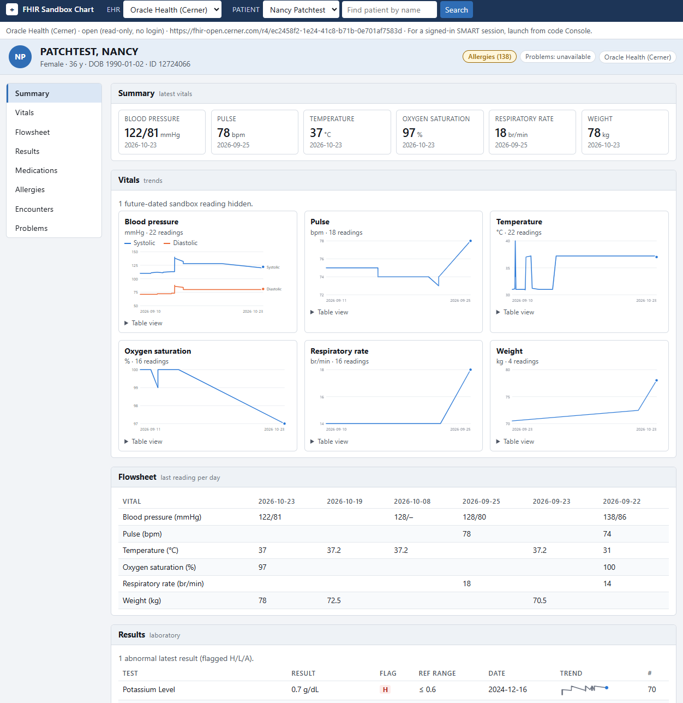

# FHIR Sandbox

Python demos and a browser dashboard for FHIR R4 sandboxes: the Oracle Health (Cerner) open sandbox, the Epic sandbox and a local HAPI FHIR server.



Based on the blog post [FHIR Practical Interoperability](https://www.doctorswhocode.blog/blog/fhir-practical-interoperability/).

## Install

Install [VS Code](https://code.visualstudio.com/), [pixi](https://pixi.sh) and [Docker](https://docs.docker.com/get-docker/) (Docker is for the local HAPI server). Then download the project (**Code > Download ZIP** on GitHub and unzip it, or `git clone https://github.com/tonyreina/ehr_sandbox.git`), open the folder in VS Code and run these in its terminal. Details: [Prerequisites](https://tonyreina.github.io/ehr_sandbox/setup/prerequisites/).

```bash
pixi install
pixi run smart-app        # patient dashboard: http://localhost:8765/index.html
```

No account is needed for the default Cerner open sandbox.

## Set up OpenAI Codex (course users)

Point Codex at the course proxy and store your **OpenAI Token** from the VS Code terminal (**Terminal > New Terminal**; works on Windows, macOS, Ubuntu and WSL):

```bash
pixi run codex-setup <openai-token>
```

Then fully quit and reopen VS Code, and confirm the token works with `pixi run codex-check` (it should end with `Result: OK`). Omit the **OpenAI Token** to be prompted for it. In a WSL window of VS Code, run it in that window's terminal. Details: [OpenAI Codex setup](https://tonyreina.github.io/ehr_sandbox/setup/codex/).

## Documentation

Setup for Epic and Cerner, authentication, the dashboard, CLI reference and test patients:

**https://tonyreina.github.io/ehr_sandbox/**

To read it locally, run `pixi run docs`.


