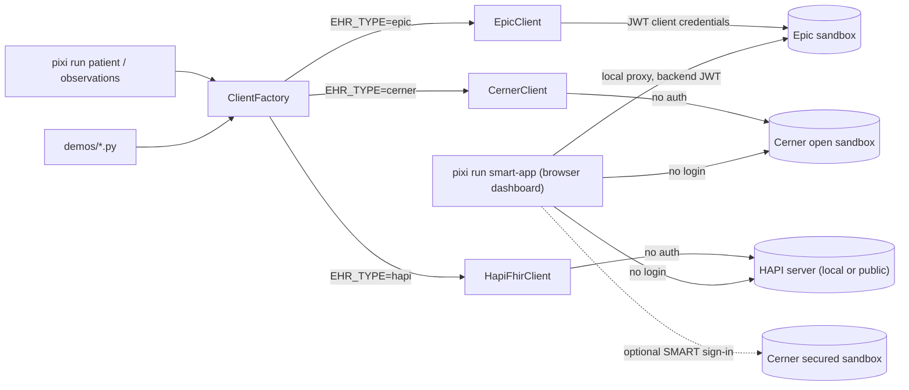

# Advanced: Epic, Cerner and the Python tools

You do not need this section for the practice patients and the Ask AI tab. It is for connecting to the Epic and Oracle Health (Cerner) sandboxes and for reading the code.

The project is built around a multi-EHR abstraction layer: set `EHR_TYPE` in `.env` (or pass `--ehr`) to target a different server without changing any code. Based on [FHIR Practical Interoperability](https://www.doctorswhocode.blog/blog/fhir-practical-interoperability/).

## What each backend needs

- **Cerner (Oracle Health) open sandbox:** nothing; no account. See [Cerner Sandbox](setup/cerner-sandbox.md).
- **Cerner signed-in mode (optional):** a CernerCare account. See [Cerner Account](setup/cerner-account.md).
- **Epic:** an Epic developer account and a GitHub account to host your public key. See [Keys](setup/keys.md), [Epic Portal](setup/epic-portal.md) and [Epic in the Dashboard](setup/epic-dashboard.md).

## How it fits together



## Supported EHR backends

| `EHR_TYPE` | Status | Auth |
|---|---|---|
| `epic` | Full | JWT client credentials (RS384) |
| `cerner` | Full (open sandbox) | None |
| `hapi` | Full | None (local dev) |

## Available commands

```bash
pixi run patient [name]            # keys depend on EHR_TYPE (or --ehr epic|cerner|hapi)
pixi run observations [name] [--category vital-signs] [--count 10] [--ehr epic|cerner|hapi]
pixi run list-patients
pixi run list-ehrs
pixi run generate-keys
pixi run smart-app        # patient dashboard on localhost: --ehr cerner | epic | hapi
pixi run smart-setup      # optional: register a signed-in Cerner SMART session
pixi run hapi-up          # local HAPI server in Docker (then: pixi run hapi-load)
pixi run codex-setup      # configure OpenAI Codex with your token
```

More: [Authentication](auth.md), [EHR Clients](ehr-clients.md), [CLI](cli.md), [Dashboard internals](demos/smart-app-internals.md), [Reference](reference.md).
