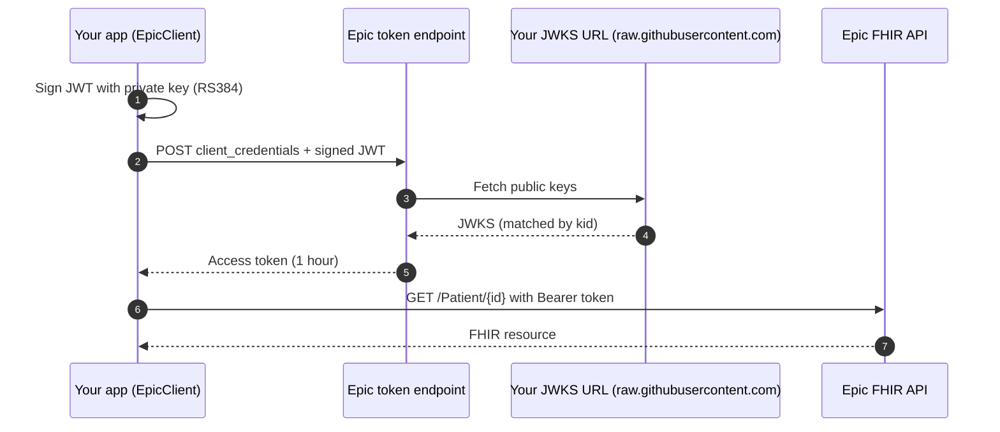
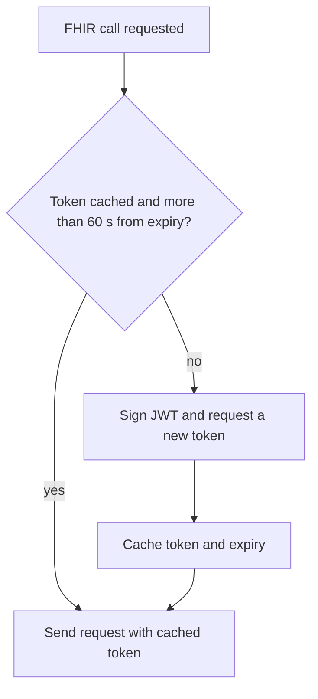
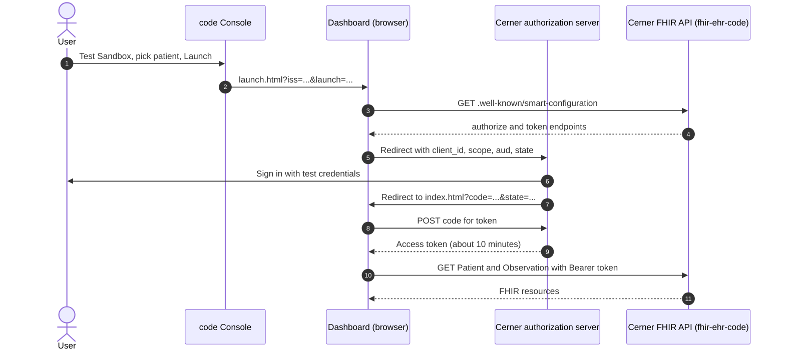
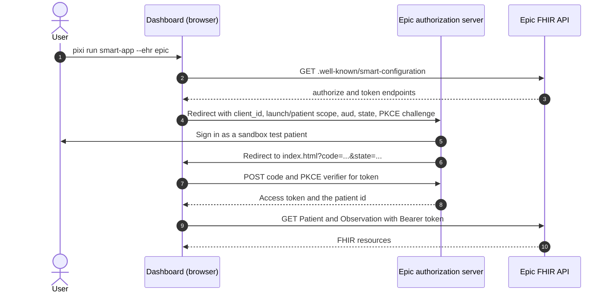

# Authentication

This page covers **Epic** backend authentication. Other backends:

- **Cerner open sandbox** (`EHR_TYPE=cerner`): no authentication.
- **Dashboard sign-in (Cerner and Epic)**: OAuth 2.0 authorization code flow with a user login, handled by `fhirclient` in the browser. See [Browser sign-in](#browser-sign-in-smart-on-fhir).
- **HAPI** (`EHR_TYPE=hapi`): no authentication.

---

Epic backend system apps use the **OAuth 2.0 client credentials** flow with a signed JWT assertion. No user login is required. This is implemented in `ehr/epic.py` (`EpicClient`).

## Flow



## JWT claims

| Claim | Value |
|---|---|
| `iss` | Your Non-Production Client ID |
| `sub` | Your Non-Production Client ID |
| `aud` | Token endpoint URL |
| `jti` | Random UUID (prevents replay) |
| `iat` | Current Unix timestamp |
| `exp` | `iat + 300` (5 minutes max) |

The JWT header must include `"kid"` matching a key in your hosted JWKS.

## Token caching

`EpicClient` caches the access token and only re-fetches it 60 seconds before expiry (tokens are valid for 1 hour). Calling `ClientFactory.from_env()` multiple times within a request does not trigger redundant token requests.



## Browser sign-in (SMART on FHIR)

The browser dashboard's signed-in mode uses the **authorization code** flow with a user login, not client credentials (a browser can't hold the backend private key). `fhirclient` discovers the endpoints from `.well-known/smart-configuration`, so none are hard-coded. Setup: [Cerner Account & Registration](setup/cerner-account.md), [Epic SMART App Registration](setup/epic-smart-app.md).

**EHR launch (Cerner Provider app):** the EHR starts the app.



**Standalone launch (Epic):** the dashboard starts the login itself, once, using the `launch/patient` scope.



## Using the client

```python
from ehr import ClientFactory

client = ClientFactory.from_env()           # reads EHR_TYPE from .env
patient = client.get_patient("erXuFYUfucBZaryVksYEcMg3")
obs     = client.get_observations("erXuFYUfucBZaryVksYEcMg3", category="laboratory")
```

## Adding a new EHR

See [EHR Clients → Adding a new backend](ehr-clients.md#adding-a-new-backend).
