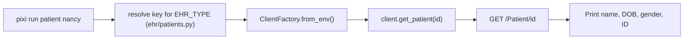

# Demo 1: Patient Demographics

Fetches a patient record via the active EHR client and prints name, DOB, and gender.

## Usage

```bash
pixi run patient [name]
```

`name` is a test-patient key for the active EHR or a raw FHIR id. Defaults to `camila` on Epic and `nancy` on Cerner. The EHR backend is determined by `EHR_TYPE` in `.env`, or by `--ehr epic|cerner|hapi` for a single run (for example `pixi run patient nancy --ehr cerner`).

## Example output

```
EHR:     Epic
Patient: Camila Lopez
DOB:     1987-09-12
Gender:  female
ID:      erXuFYUfucBZaryVksYEcMg3
```

## Known sandbox patients (Epic)

Run `pixi run list-patients` for the full table.

| Key | Name | DOB | Sex | FHIR ID |
|---|---|---|---|---|
| `camila` | Camila Lopez | 1987-09-12 | F | `erXuFYUfucBZaryVksYEcMg3` |
| `derrick` | Derrick Lin | 1973-06-03 | M | `eq081-VQEgP8drUUqCWzHfw3` |
| `theodore` | Theodore Mychart | 1948-07-07 | M | `e63wRTbPfr1p8UW81d8Seiw3` |
| `linda` | Linda Ross | 1969-04-27 | F | `eIXesllypH3M9tAA5WdJftQ3` |
| `warren` | Warren McGinnis | 1952-05-24 | M | `e0w0LEDCYtfckT6N.CkJKCw3` |
| `desiree` | Desiree Powell | 2014-11-14 | F | `eAB3mDIBBcyUKviyzrxsnAw3` |
| `elijah` | Elijah Davis | 1993-08-18 | M | `egqBHVfQlt4Bw3XGXoxVxHg3` |
| `jason` | Jason Argonaut | 1985-08-01 | M | `eD.LxhDyX35TntF77l7etUA3` |

## Known sandbox patients (Cerner)

With `EHR_TYPE=cerner`:

| Key | Name | DOB | Sex | FHIR ID |
|---|---|---|---|---|
| `nancy` | Nancy Patchtest | 1990-01-02 | F | `12724066` |
| `joe` | Joe Testpatient | 1990-05 | M | `12724067` |
| `wilm` | Wilm Smart | 1990-09-15 | M | `12724065` |
| `tim` | Tim Peters | 1990-09-15 | M | `12742400` |

```
EHR:     Cerner
Patient: NANCY PATCHTEST
DOB:     1990-01-02
Gender:  female
ID:      12724066
```

## How it works

`demos/demo_01_patient.py` calls `ClientFactory.from_env()` which returns whichever `BaseEHRClient` matches `EHR_TYPE`. The same script runs unchanged against Epic, HAPI, or any other registered backend.

```python
from ehr import ClientFactory

client  = ClientFactory.from_env()
patient = client.get_patient(patient_id)
```



## FHIR resource

Reads from the R4 `Patient` resource:

- `name[0].given[0]` — first name
- `name[0].family` — last name
- `birthDate` — date of birth
- `gender` — administrative gender
