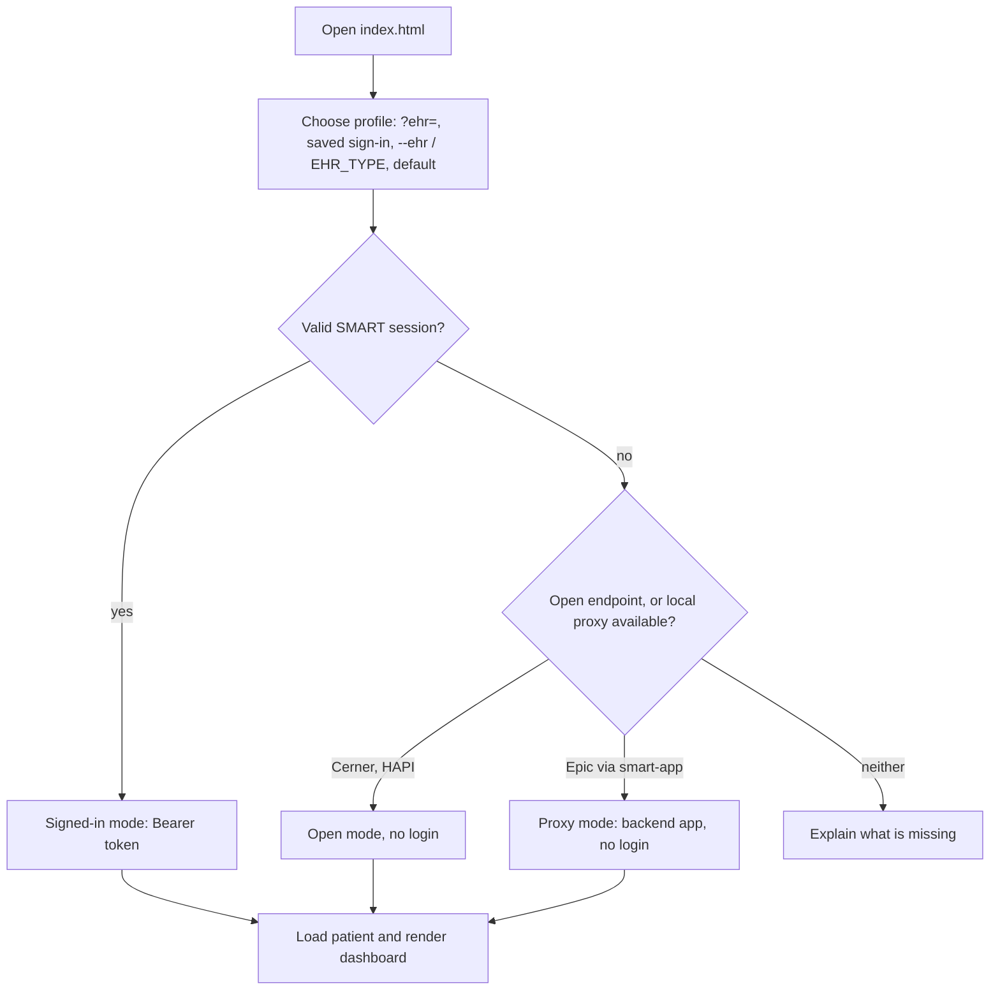

# Dashboard internals and sign-in

A browser dashboard for FHIR R4 sandboxes: patient summary, latest vitals, trend charts, lab results with sparklines, medications, allergies, encounters and problems. **One UI, several EHRs**: pick the EHR from the dropdown at the top (or `--ehr` on the command line).

| EHR | No-login mode | Signed-in mode | Setup |
|---|---|---|---|
| **Oracle Health (Cerner)** | yes: the open sandbox | optional (SMART, Provider app launched from code Console) | none for open mode |
| **HAPI FHIR** | yes: your [local server with Synthea patients](../setup/local-hapi.md), else public `hapi.fhir.org` | n/a | none for the public server; Docker for the local one |
| **Epic** | yes: through a local proxy that uses your backend app | n/a | your existing Backend Systems app (`.env`, `keys/`) |

## Quick start

```bash
pixi install
pixi run smart-app                # http://localhost:8765/index.html (Cerner, no login)
pixi run smart-app --ehr hapi     # HAPI: starts your local server, stops it on Ctrl-C (else the public one)
pixi run smart-app --ehr epic     # Epic: uses your backend app from .env and keys/
```

`--ehr` only sets the starting EHR (default: `EHR_TYPE` from `.env`, else Cerner); the page's EHR dropdown switches at any time. Use the **Patient** dropdown or the name search (for example `smart`) to switch patients.

## Screenshots

Oracle Health (Cerner) open sandbox, no login:


Epic through the local proxy (Epic finds patients by name only together with a birth date):


HAPI on your own machine, filled with Synthea patients ([Local HAPI Server](../setup/local-hapi.md)):


## What it shows

The page is laid out like a clinical chart: an app bar with the EHR and patient selectors, a **patient banner** (name, sex, age, DOB, ID, and allergy / problem chips), and an activity **sidebar** that tracks the section in view.

- **Latest vitals** tiles and **trend charts** (blood pressure with systolic and diastolic, pulse, temperature, oxygen saturation, respiratory rate, weight). Hover or use the arrow keys for a crosshair tooltip; every chart has a *Table view*. Far-future sandbox timestamps are hidden and counted.
- **Flowsheet:** vitals by day (newest first), the way nursing flowsheets show them.
- **Results:** latest value per test with an **H / L / A flag** (the EHR's interpretation, else the reference range), the reference range and a sparkline of its history.
- **Medications, allergies, encounters, problems.** Each section loads independently, so a slow or forbidden resource never blocks the page.

The sandboxes are shared and their data is synthetic (for example implausible potassium values) and changes over time. Some Cerner searches are slow: labs take ~10 s and problems can take 30+ s, so those sections show *Loading…* and problems give up after 45 s.

## How it picks an EHR and a mode



A profile can also start a SMART login itself (`standaloneIss`); it then redirects at most once per browser session, and a failed or cancelled login returns with a notice and a **Sign in** button instead of looping. None of the built-in profiles needs this today: a Cerner Provider app is launched by the EHR, and Epic uses the proxy.


## Files

```
smart-app/
├── index.html       the dashboard (also the SMART redirect target)
├── app.js           profile/mode selection, loading, rendering, picker/search
├── lib.js           pure helpers: FHIR transforms, profile choice, scopes (node-testable)
├── charts.js        dependency-free SVG line charts and sparklines
├── style.css        light/dark theme tokens
├── config.js        EHR profiles (servers, scopes, test patients)
├── config.local.js  your per-EHR client ids (generated by smart-setup, gitignored)
├── launch.html      starts the SMART authorization (any profile)
└── __ehr.js         served by `pixi run smart-app` only: starting EHR and available proxies
```

`fhirclient` 2.5.2 (jsDelivr) is used for requests in every mode and for the OAuth flow when signing in (PKCE is used when the server supports it). The Epic proxy lives in `cli.py` (`smart-app`) and uses `EpicClient.get_raw()` from `ehr/epic.py`.

## Profiles

Each EHR is a profile in `smart-app/config.js`:

| Field | Meaning |
|---|---|
| `openBase` | no-login FHIR base URL, or `null` |
| `proxy` | path of a local proxy served by `smart-app` (Epic) |
| `standaloneIss` | where the app can start the login itself; `null` if the EHR must launch it |
| `issMatch` | host fragment that identifies the EHR when it launches the app |
| `resources` | resources requested at sign-in (each needs a registered scope) |
| `patients` | test patients for the picker (empty: list the server's first patients) |
| `conditionCategory` | category used for the Problems search |
| `searchNeedsBirthDate` | the EHR only finds patients by name plus birth date (Epic) |

Add an EHR by adding a profile; the rendering code is plain FHIR R4 and shared. A different server for an open profile can be tried with `?base=`, for example `index.html?ehr=hapi&base=http://localhost:8080/fhir` for a local [HAPI](https://hapifhir.io) Docker container.

## Signing in (Cerner, optional)

Only Cerner has a browser sign-in; Epic uses the proxy (see [Epic in the Dashboard](../setup/epic-dashboard.md)) and HAPI has no login.

```bash
pixi run smart-setup --ehr cerner
```

prints the exact values to enter in code Console, saves the client ID you get back in `smart-app/config.local.js` and checks the sandbox is reachable. Registering is manual because Oracle provides no API for it and it needs your login. Then launch from code Console: your app → **Test Sandbox** → pick a patient → **Launch**. Details: [Cerner Account & Registration](../setup/cerner-account.md); the login sequence is diagrammed in [Authentication](../auth.md#browser-sign-in-smart-on-fhir).

### Scopes

The app requests `Patient` and `Observation` by default (`resources` in the profile). To also load the other sections when signed in, register their scopes with the EHR **and** add the resource names to the profile; sections without a scope show *Not authorized*. Requesting a scope you didn't register can make the EHR reject the whole sign-in.

- Provider/clinician launches use `user/…` scopes, which let the signed-in user read any patient they can access, so the picker and search work.
- Patient (standalone) logins use `patient/…` scopes, which only cover the patient who logged in, so the picker shows that one patient and search is hidden.

### Notes

- A client is only accepted by the persona matching its app type. Opening `launch.html` directly with a Cerner **Provider** app fails with `client-persona-mismatch`; launch from code Console. For a standalone Cerner login register a *Patient* app and set the profile's `standaloneIss` to the `fhir-myrecord` URL.
- `index.html` must be reached through the redirect. If you reload it after an expired or failed sign-in, an open profile falls back to open mode and says why.
- Cerner access tokens last about 10 minutes; launch again when they expire. The Epic proxy refreshes its token by itself.
- Client ids are identifiers, not secrets. The Cerner app is a public client with no secret; the Epic private key stays in the `smart-app` Python process and never reaches the browser.
- Verified against the live sandboxes: Cerner open mode, HAPI, and Epic through the proxy. The Cerner sign-in itself needs your own code Console registration.
