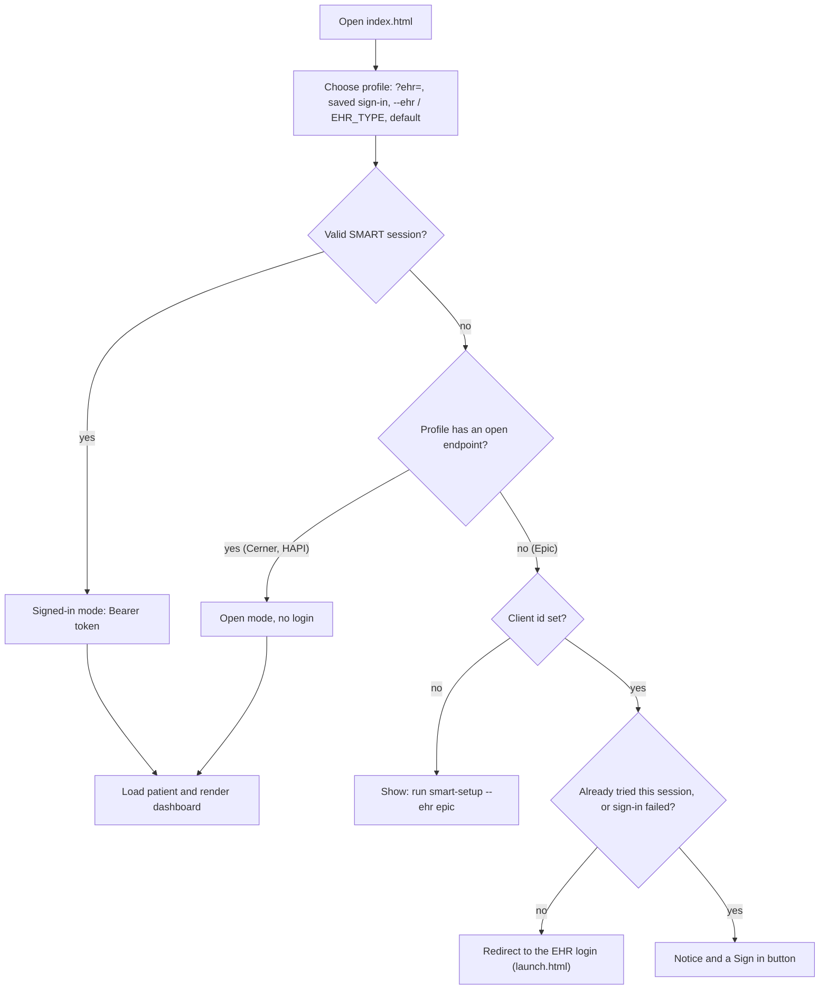

# Demo 3: Patient Dashboard

A browser dashboard for FHIR R4 sandboxes: patient summary, latest vitals, trend charts, lab results with sparklines, medications, allergies, encounters and problems. **One UI, several EHRs**: pick the EHR from the dropdown at the top (or `--ehr` on the command line).

| EHR | No-login mode | Signed-in mode | Setup |
|---|---|---|---|
| **Oracle Health (Cerner)** | yes: the open sandbox | optional (SMART, Provider app launched from code Console) | none for open mode |
| **HAPI FHIR** | yes: public `hapi.fhir.org`, or your local server | n/a | none |
| **Epic** | no: Epic has no open endpoint | required; the dashboard starts the login itself | register an app once |

## Quick start

```bash
pixi install
pixi run smart-app                # http://localhost:8765/index.html (Cerner, no login)
pixi run smart-app --ehr hapi     # HAPI public server, no login
pixi run smart-app --ehr epic     # Epic: needs `smart-setup --ehr epic` first
```

`--ehr` only sets the starting EHR (default: `EHR_TYPE` from `.env`, else Cerner); the page's EHR dropdown switches at any time. Use the **Patient** dropdown or the name search (for example `smart`) to switch patients.

## What it shows

- **Latest vitals** tiles and **trend charts** (blood pressure with systolic and diastolic, pulse, temperature, oxygen saturation, respiratory rate, weight). Hover or use the arrow keys for a crosshair tooltip; every chart has a *Table view*. Far-future sandbox timestamps are hidden and counted.
- **Laboratory:** latest value per test with a sparkline of its history.
- **Medications, allergies, encounters, problems.** Each section loads independently, so a slow or forbidden resource never blocks the page.

The sandboxes are shared and their data is synthetic (for example implausible potassium values) and changes over time. Some Cerner searches are slow: labs take ~10 s and problems can take 30+ s, so those sections show *Loading…* and problems give up after 45 s.

## How it picks an EHR and a mode



The automatic sign-in redirects at most once per browser session; a failed or cancelled login returns with a notice and a **Sign in** button instead of looping. A Provider app (Cerner) can't be started by the dashboard: the EHR launches it, so there is no Sign in button for it.

## Files

```
smart-app/
├── index.html       the dashboard (also the SMART redirect target)
├── app.js           profile/mode selection, loading, rendering, picker/search
├── lib.js           pure helpers: FHIR transforms, profile choice, scopes (node-testable)
├── charts.js        dependency-free SVG line charts and sparklines
├── style.css        light/dark theme tokens
├── config.js        EHR profiles (servers, scopes, test patients)
├── config.local.js  your per-EHR client ids (generated by smart-setup, gitignored)
├── launch.html      starts the SMART authorization (any profile)
└── __ehr.js         served by `pixi run smart-app` only: the starting EHR
```

`fhirclient` 2.5.2 (jsDelivr) is used for requests in every mode and for the OAuth flow when signing in (PKCE is used when the server supports it).

## Profiles

Each EHR is a profile in `smart-app/config.js`:

| Field | Meaning |
|---|---|
| `openBase` | no-login FHIR base URL, or `null` if sign-in is required |
| `standaloneIss` | where the app can start the login itself; `null` if the EHR must launch it |
| `issMatch` | host fragment that identifies the EHR when it launches the app |
| `resources` | resources requested at sign-in (each needs a registered scope) |
| `patients` | test patients for the picker (empty: list the server's first patients) |
| `conditionCategory` | category used for the Problems search |

Add an EHR by adding a profile; the rendering code is plain FHIR R4 and shared. A different server for an open profile can be tried with `?base=`, for example `index.html?ehr=hapi&base=http://localhost:8080/fhir` for a local [HAPI](https://hapifhir.io) Docker container.

## Signing in

Cerner needs this only for a signed-in session; Epic always needs it.

```bash
pixi run smart-setup --ehr cerner   # or --ehr epic
```

prints the exact values to enter, saves the client ID you get back in `smart-app/config.local.js` (one entry per EHR) and checks the sandbox is reachable. Registering is manual because neither EHR provides an API for it and both need your login.

- **Cerner:** [Cerner Account & Registration](../setup/cerner-account.md). Launch from code Console: your app → **Test Sandbox** → pick a patient → **Launch**.
- **Epic:** [Epic SMART App Registration](../setup/epic-smart-app.md). Open the dashboard with `--ehr epic`; it redirects to Epic's login by itself.

The login sequences are diagrammed in [Authentication](../auth.md#browser-sign-in-smart-on-fhir).

### Scopes

The app requests `Patient` and `Observation` by default (`resources` in the profile). To also load the other sections when signed in, register their scopes with the EHR **and** add the resource names to the profile; sections without a scope show *Not authorized*. Requesting a scope you didn't register can make the EHR reject the whole sign-in.

- Provider/clinician launches use `user/…` scopes, which let the signed-in user read any patient they can access, so the picker and search work.
- Patient (standalone) logins use `patient/…` scopes, which only cover the patient who logged in, so the picker shows that one patient and search is hidden.

### Notes

- A client is only accepted by the persona matching its app type. Opening `launch.html` directly with a Cerner **Provider** app fails with `client-persona-mismatch`; launch from code Console. For a standalone Cerner login register a *Patient* app and set the profile's `standaloneIss` to the `fhir-myrecord` URL.
- `index.html` must be reached through the redirect. If you reload it after an expired or failed sign-in, an open profile falls back to open mode and says why.
- Access tokens last about an hour (Epic) or 10 minutes (Cerner); sign in again when they expire.
- Client ids are identifiers, not secrets; these are public clients and no secret or private key is used. The Epic backend key from the Python demos can't be used in a browser.
- The Cerner and HAPI paths were verified against the live sandboxes. The Epic path was verified against a mocked Epic (discovery, authorize redirect with PKCE and scopes, token exchange, FHIR calls), not the live sandbox.
