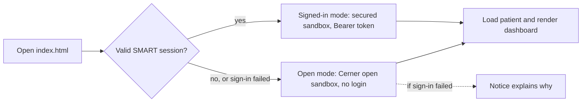

# Demo 3: Patient Dashboard

A browser dashboard for the Oracle Health (Cerner) sandbox: patient summary, latest vitals, trend charts, lab results with sparklines, medications, allergies, encounters and problems. It runs in two modes that share all the code:

| Mode | Login | Setup | Data |
|---|---|---|---|
| **Open** (default) | none | none | the public, read-only open sandbox |
| **Signed in** (optional) | code Console launch | register an app once | the secured sandbox via SMART on FHIR |

## Quick start

```bash
pixi install
pixi run smart-app     # http://localhost:8765/index.html — opens in your browser
```

That's it: no account, keys or registration. Use the **Patient** dropdown, or search by name (for example `smart`), to switch patients.

## How it picks a mode



A session counts as valid when the URL carries the authorization `code` (or a SMART session is saved) and `FHIR.oauth2.ready()` succeeds. An `?error=` redirect or a failed exchange falls back to open mode with a notice.

## What it shows

- **Latest vitals** tiles and **trend charts** (blood pressure with systolic and diastolic, pulse, temperature, oxygen saturation, respiratory rate, weight). Hover or use the arrow keys for a crosshair tooltip; every chart has a *Table view*. Far-future sandbox timestamps are hidden and counted.
- **Laboratory:** latest value per test with a sparkline of its history.
- **Medications, allergies, encounters, problems.** Each section loads independently, so a slow or forbidden resource never blocks the page.

The sandbox is shared and its data is synthetic (for example implausible potassium values) and changes over time. Some searches are slow: labs take ~10 s and problems can take 30+ s, so those sections show *Loading…* and problems give up after 45 s.

## Files

```
smart-app/
├── index.html       the dashboard (also the SMART redirect target)
├── app.js           mode selection, loading, rendering, patient picker/search
├── lib.js           pure FHIR helpers (no DOM; unit-testable under node)
├── charts.js        dependency-free SVG line charts and sparklines
├── style.css        light/dark theme tokens
├── config.js        shared settings and the test-patient list
├── config.local.js  your client id (generated by smart-setup, gitignored)
└── launch.html      starts the SMART authorization (signed-in mode only)
```

`fhirclient` 2.5.2 (jsDelivr) is used for requests in both modes and for the OAuth flow in signed-in mode.

## Signed-in mode (optional)

Open mode never needs this. To exercise a real SMART launch:

```bash
pixi run smart-setup   # prints the exact values to enter in code Console, saves your client ID
pixi run smart-app
```

The launch sequence is diagrammed in [Authentication](../auth.md#cerner-smart-on-fhir-dashboard).

Registering the app is the one manual step: Oracle provides no API for it and it needs your CernerCare login. Then in [code Console](https://code-console.cerner.com/): your app → **Test Sandbox** → pick a patient → **Launch**. Cerner opens `launch.html?iss=…&launch=…`, you log in, and the dashboard header changes to *Signed in via SMART on FHIR*.

### Registration values

| Field | Value |
|---|---|
| Application Type | **Provider** |
| Type of Access | Online |
| Application Privacy | Public |
| SMART Version | SMART v1 |
| Default FHIR Version | **R4** |
| Redirect URI | `http://localhost:8765/index.html` |
| SMART Launch URI | `http://localhost:8765/launch.html` |
| Scopes | `launch`, `online_access`, `openid`, `fhirUser`, `user/Patient.read`, `user/Observation.read`, plus any of `user/MedicationRequest.read`, `user/AllergyIntolerance.read`, `user/Encounter.read`, `user/Condition.read` |

Wildcard scopes are not supported and new registrations take a few minutes to propagate.

The app requests `Patient` and `Observation` by default (`smartResources` in `config.js`). To also load the other sections when signed in, add their scopes in code Console **and** add the resource names to `smartResources`; sections without a scope show *Not authorized*. Requesting a scope you didn't register makes Cerner reject the whole sign-in.

### Notes on signing in

- Provider apps use `user/…` scopes; Patient apps use `patient/…` (override with `?scope_prefix=`). `user/…` scopes let the signed-in user read any patient they can access, so the picker works beyond the launch patient.
- A client is only accepted by the persona matching its App type. Opening `launch.html` directly with a Provider app fails with `client-persona-mismatch`; launch from code Console. For standalone launch, register a *Patient* app and set `appType: "patient"` in `config.js`.
- `index.html` must be reached through the redirect. If you reload it or open it directly after a failed or expired sign-in, the dashboard falls back to open mode and says why.
- Access tokens last about 10 minutes.
- The client id is an identifier, not a secret; this is a public client and no secret or private key is used.
- Not verified in automated testing: the login step needs your own code Console registration.
