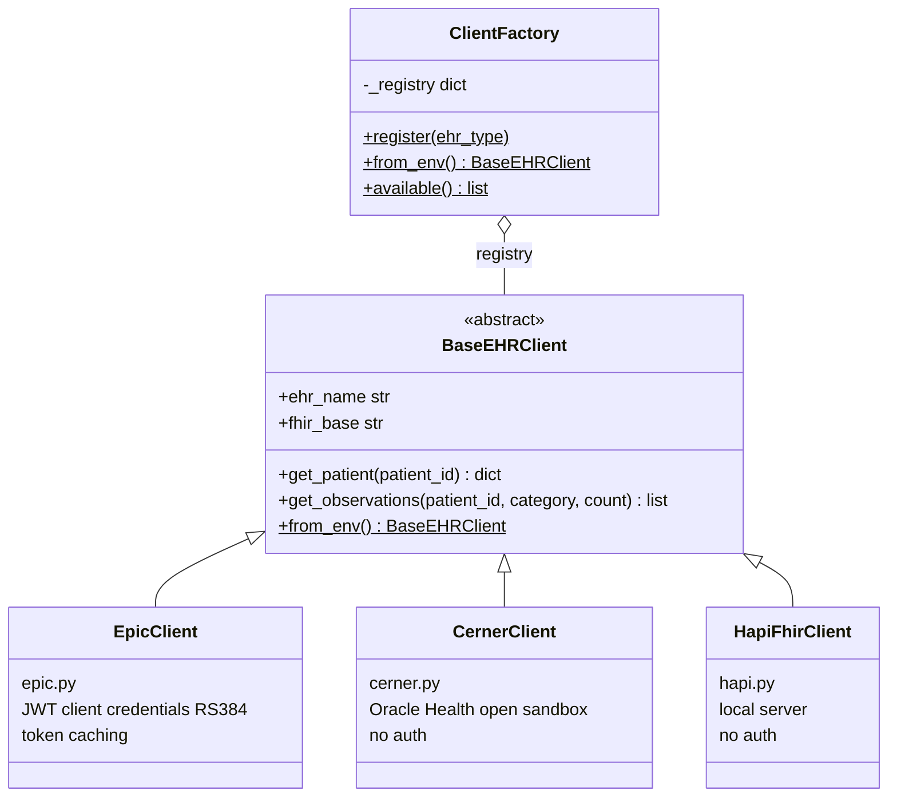
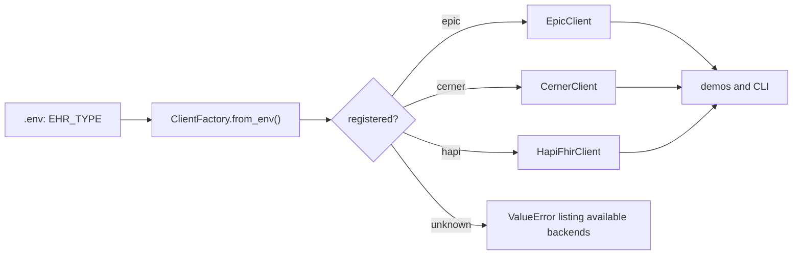

# EHR Clients

The `ehr/` package provides a thin abstraction layer so the demos and CLI work against any FHIR server by changing a single environment variable.

## Architecture



Test patients per EHR and their defaults live in `ehr/patients.py`. The browser dashboard (`smart-app/`) does not use these Python clients; it has its own EHR profiles in `smart-app/config.js`, see [Demo 3](demos/smart-app.md).

### BaseEHRClient

Every client exposes three things:

```python
class BaseEHRClient(ABC):
    ehr_name: str                          # "Epic", "Cerner", …
    fhir_base: str                         # base URL of the FHIR server
    get_patient(patient_id) -> dict        # raw FHIR Patient resource
    get_observations(patient_id,           # list of raw Observation resources
                     category, count) -> list[dict]
    from_env() -> BaseEHRClient            # classmethod — reads env vars
```

### ClientFactory

Clients register themselves with a decorator:

```python
@ClientFactory.register("epic")
class EpicClient(BaseEHRClient):
    ...
```

`ehr/__init__.py` imports every module to trigger registration. The factory then resolves the active client at runtime:



```python
from ehr import ClientFactory

client = ClientFactory.from_env()   # reads EHR_TYPE from .env, default "epic"
```

## Switching EHR backends

Change `EHR_TYPE` in `.env` — no code changes required:

```bash
# .env
EHR_TYPE=hapi
HAPI_FHIR_BASE=http://localhost:8080/fhir
```

```bash
pixi run list-ehrs   # shows active backend
pixi run patient <fhir-id>
```

Or pick the backend for a single command with `--ehr`, leaving `.env` alone:

```bash
pixi run patient nancy --ehr cerner
```

## Supported backends

### epic

Full implementation. Authenticates via JWT client credentials (RS384).

Required `.env` keys:

```
EHR_TYPE=epic
EPIC_CLIENT_ID=<non-production client id>
EPIC_FHIR_BASE=https://fhir.epic.com/interconnect-fhir-oauth/api/FHIR/R4
EPIC_TOKEN_URL=https://fhir.epic.com/interconnect-fhir-oauth/oauth2/token
```

See [Setup → Epic Portal](setup/epic-portal.md) for app registration.

### hapi

Unauthenticated client for a local [HAPI FHIR](https://hapifhir.io) server. Useful for development and testing without Epic credentials.

```bash
docker run -p 8080:8080 hapiproject/hapi:latest
```

```
EHR_TYPE=hapi
HAPI_FHIR_BASE=http://localhost:8080/fhir
```

### cerner

Unauthenticated client for the Oracle Health (Cerner) open sandbox. Works with no setup beyond:

```
EHR_TYPE=cerner
# optional — defaults to the public sandbox tenant
CERNER_FHIR_BASE=https://fhir-open.cerner.com/r4/ec2458f2-1e24-41c8-b71b-0e701af7583d
```

See [Setup → Cerner Sandbox](setup/cerner-sandbox.md). Secured (authenticated) Cerner endpoints are not implemented.

## Adding a new backend

1. Create `ehr/<name>.py` and subclass `BaseEHRClient`:

    ```python
    from ehr.base import BaseEHRClient
    from ehr.factory import ClientFactory

    @ClientFactory.register("myehr")
    class MyEHRClient(BaseEHRClient):

        @property
        def ehr_name(self) -> str:
            return "My EHR"

        @property
        def fhir_base(self) -> str:
            return os.environ["MYEHR_FHIR_BASE"]

        def get_patient(self, patient_id: str) -> dict:
            r = self._session.get(f"{self.fhir_base}/Patient/{patient_id}")
            r.raise_for_status()
            return r.json()

        def get_observations(self, patient_id, category="laboratory", count=20):
            ...

        @classmethod
        def from_env(cls) -> "MyEHRClient":
            load_dotenv(override=True)
            return cls(...)
    ```

2. Import it in `ehr/__init__.py` to trigger registration:

    ```python
    import ehr.myehr  # noqa: F401 — registers "myehr"
    ```

3. Set `EHR_TYPE=myehr` in `.env` and run any command.
