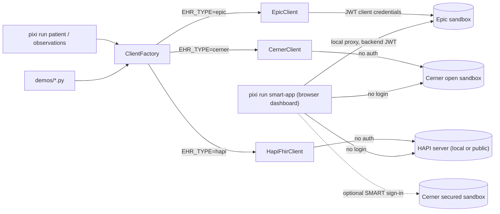

# FHIR Sandbox

Python demos for querying FHIR R4 servers: Epic (backend system OAuth 2.0 client credentials) and the Oracle Health (Cerner) open sandbox (no auth).

The project is built around a multi-EHR abstraction layer — swap `EHR_TYPE` in `.env` to target a different server without changing any code.

Based on [FHIR Practical Interoperability](https://www.doctorswhocode.blog/blog/fhir-practical-interoperability/).

## How it fits together



## Supported EHR backends

| `EHR_TYPE` | Status | Auth |
|---|---|---|
| `epic` | Full | JWT client credentials (RS384) |
| `cerner` | Full (open sandbox) | None |
| `hapi` | Full | None (local dev) |

## Available commands

```bash
pixi run patient [name]            # keys depend on EHR_TYPE (or --ehr epic|cerner|hapi)
pixi run observations [name] [--category vital-signs] [--count 10] [--ehr epic|cerner|hapi]
pixi run list-patients
pixi run list-ehrs
pixi run generate-keys
pixi run smart-app        # patient dashboard on localhost: --ehr cerner | epic | hapi
pixi run smart-setup      # optional: register a signed-in Cerner SMART session
```

See [Setup → Prerequisites](setup/prerequisites.md) to get started, or [EHR Clients](ehr-clients.md) for the architecture.
