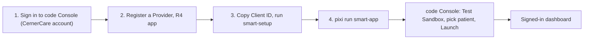

# Oracle Health (Cerner) Account & App Registration

You only need this for the **signed-in SMART on FHIR mode** of the [patient dashboard](../demos/smart-app.md). The Python demos (`EHR_TYPE=cerner`) and the dashboard's default mode use the [open sandbox](cerner-sandbox.md), which needs no account.



## 1. Get an account

Registration happens in **code Console**, Oracle Health's developer portal:

1. Go to <https://code-console.cerner.com/>.
2. Sign in with a **CernerCare** account. Oracle's documentation says an account can be created the first time you sign in, so follow the prompts on the sign-in page if you don't have one.
3. Complete any email verification it asks for. Afterwards you should reach **My Applications**.

Oracle's own overview is [Build SMART on FHIR apps](https://docs.oracle.com/en/industries/health/millennium-platform-apis/build-smart-on-fhir-apps/); questions go to the [Oracle Health developer forums](https://forums.oracle.com/ords/apexds/domain/open-developer-experience).

## 2. Register the app

```bash
pixi run smart-setup --ehr cerner
```

prints the values below and opens code Console. In **My Applications**, create a new application and enter:

| Field | Value |
|---|---|
| Application Type | **Provider** |
| Type of Access | Online |
| Application Privacy | Public |
| SMART Version | SMART v1 |
| Default FHIR Version | **R4** |
| Redirect URI | `http://localhost:8765/index.html` |
| SMART Launch URI | `http://localhost:8765/launch.html` |
| Scopes | `launch`, `online_access`, `openid`, `fhirUser`, `user/Patient.read`, `user/Observation.read` |

Field labels may differ slightly as Oracle updates the portal. The values that matter are Provider, R4, the two URIs, and the scopes.

Notes:

- **Provider vs Patient.** The App Type decides which login the server expects. This project's launch flow is the Provider (EHR launch) one. A Provider app cannot be started by opening `launch.html` yourself; it must be launched from code Console (step 4).
- **Scopes are explicit.** Wildcards (`user/*.read`) are not supported, and every scope the app requests must be registered.
- **Optional resources.** To also show medications, allergies, encounters and problems when signed in, register `user/MedicationRequest.read`, `user/AllergyIntolerance.read`, `user/Encounter.read` and `user/Condition.read` too. See step 5.
- **Propagation.** New or edited registrations can take a few minutes to take effect. If a launch fails right after saving, wait and retry.

## 3. Save the client ID

Open the application's details page and copy the **Client ID** (a UUID such as `00000000-0000-0000-0000-000000000000`). Note this is different from the **Application ID** shown above it. `smart-setup` prompts for it, validates the format and writes `smart-app/config.local.js`:

```bash
pixi run smart-setup --ehr cerner --client-id <your-client-id>
```

`config.local.js` is gitignored and keeps one client ID per EHR. The client ID is an identifier, not a secret: this is a public client, with no client secret or private key.

## 4. Launch

```bash
pixi run smart-app --ehr cerner
```

Then in code Console: your application → **Test Sandbox** → choose a sandbox patient → **Launch**. Cerner opens `launch.html`, you sign in with the test credentials it shows, and you land on the dashboard with *Signed in via SMART on FHIR* in the header.

The launch carries one patient. Use the dashboard's **Patient** dropdown or name search to view others; `user/…` scopes allow reading any patient the signed-in user can access.

## 5. Load more resources (optional)

By default the signed-in launch requests only `Patient` and `Observation`, so the other dashboard sections show *Not authorized*. To enable them:

1. In code Console add the `user/<Resource>.read` scopes listed above to the app and save.
2. In `smart-app/config.js` extend the Cerner profile's list:

    ```javascript
    resources: ["Patient", "Observation", "MedicationRequest",
                "AllergyIntolerance", "Encounter", "Condition"],
    ```

3. Wait a few minutes, then launch again from code Console.

Requesting a scope that is not registered makes Cerner reject the whole sign-in, so keep the two lists in sync.

## Troubleshooting

| Symptom | Cause and fix |
|---|---|
| `unauthorized_client` / `client-persona-mismatch` | The launch used the wrong persona. Provider apps must be launched from code Console, not by opening `launch.html` directly. For standalone launch register a *Patient* app and set the Cerner profile's `standaloneIss` to the `fhir-myrecord` URL in `config.js`. |
| `403 insufficient_scope` / `no_scope_for_resource_path` | The token has no scope for that resource. The registered scopes don't match what the app requests (a Provider app needs `user/…`, a Patient app `patient/…`). Compare with the app's scopes in code Console. |
| `invalid_scope` or the sign-in is rejected outright | `resources` in the Cerner profile in `config.js` includes a resource whose scope you didn't register. |
| `No 'state' parameter found` | `index.html` was opened or reloaded without the redirect parameters. Launch again from code Console. The dashboard now falls back to the open sandbox and says why. |
| *No client id* on `launch.html` | Run `pixi run smart-setup --ehr cerner`. |
| `redirect_uri` error | The Redirect URI in code Console must match `http://localhost:8765/index.html` exactly, including the port. |
| Token expires mid-session | Access tokens last about 10 minutes. Launch again. |
