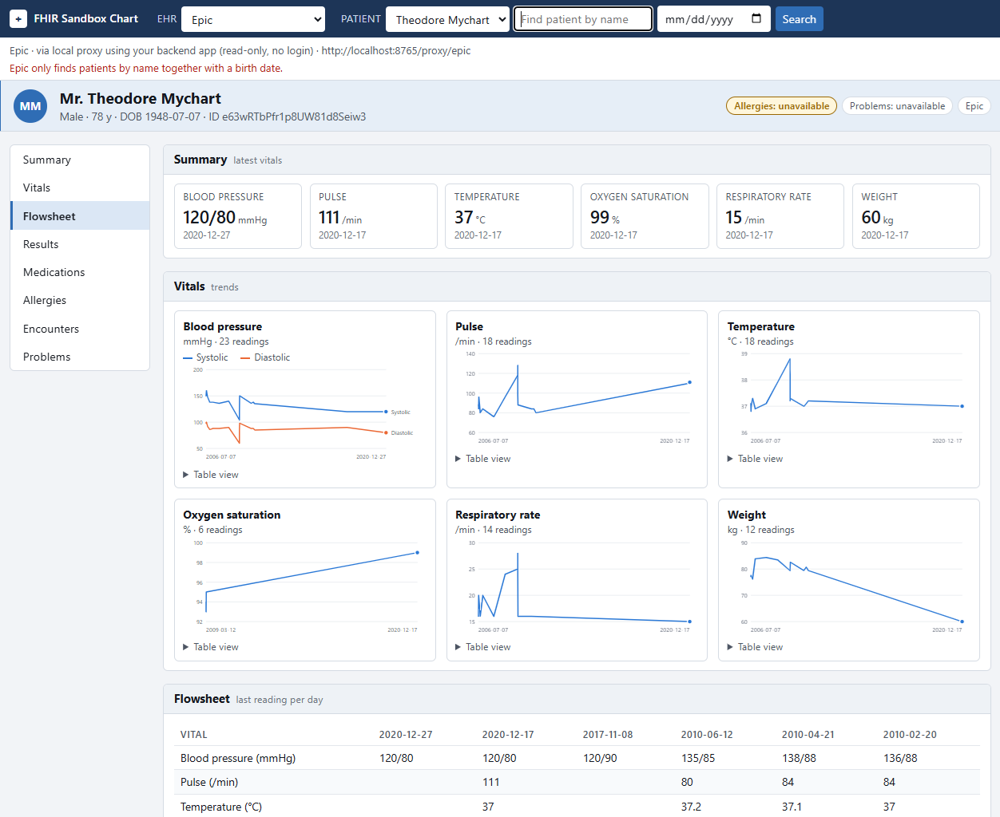
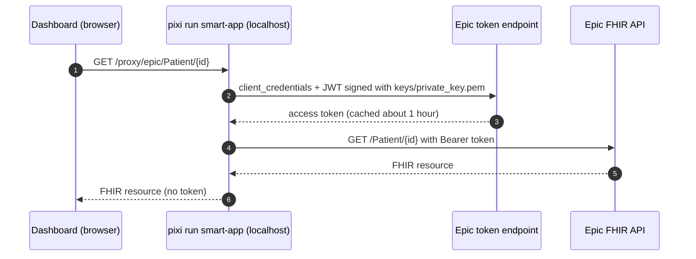

# Epic in the Dashboard

The dashboard reaches Epic with the **Backend Systems app you already use for the Python demos**. There is nothing extra to register and no login: `pixi run smart-app` signs in server-side with your private key and passes the dashboard's read requests through to Epic.





## Requirements

The same setup as the Python demos:

- `.env` with `EPIC_CLIENT_ID`, `EPIC_FHIR_BASE`, `EPIC_TOKEN_URL`
- `keys/private_key.pem` and `keys/public_jwks.json` from `pixi run generate-keys`, with the JWKS hosted at a `raw.githubusercontent.com` URL

See [Epic Portal](epic-portal.md) and [Keys](keys.md). `EHR_TYPE` does not need to be `epic`.

## Run

```bash
pixi run smart-app --ehr epic
```

The startup line says `Epic: via local proxy using your backend app` when the configuration is found. You can also pick **Epic** from the EHR dropdown at any time.

- **Patients:** the picker lists the Epic test patients (Camila Lopez, Derrick Lin, Theodore Mychart, Linda Ross, Warren McGinnis).
- **Search:** Epic only finds patients by **name together with a birth date** (for example `lin` and `1973-06-03`), so the search box has a date field for Epic.
- **Sections:** your backend app has the Patient and Observation APIs, so the summary, vitals and labs load. Medications, allergies, encounters and problems show *Not authorized* until you add their APIs to the backend app (MedicationRequest, AllergyIntolerance, Encounter and Condition search, R4) and they reach the sandbox, which can take up to about an hour.

## How the proxy is protected

- It runs inside `pixi run smart-app` and listens on `127.0.0.1` only.
- It accepts `GET` only, and only relative FHIR paths under your Epic FHIR base: absolute URLs and `..` segments (also when percent-encoded) are rejected with `400`.
- The private key and the access token stay in the Python process; the browser only ever talks to `localhost`.
- A plain static server (for example `python -m http.server`) has no proxy, so Epic shows *Open this page through pixi run smart-app*.

## Troubleshooting

| Symptom | Cause and fix |
|---|---|
| *Epic isn't configured* | `.env` lacks an `EPIC_*` value or `keys/` lacks the key files. Run `pixi run smart-setup --ehr epic` to check, and see [Epic Portal](epic-portal.md). |
| Sections show *Epic request failed* (502) | The token request failed. Run `pixi run patient camila --ehr epic`; it uses the same credentials and shows the full error. A JWKS hosted as a Gist causes `invalid_client`. |
| *Not authorized* in a section | That resource's API isn't on your backend app yet. |
| Search finds nothing | Add the birth date; Epic needs name plus birth date. |
| Epic's login page says **Invalid OAuth 2.0 request.** | A Backend Systems client ID was used for a browser login. The dashboard no longer does that; if you see it, you are on an old version of `smart-app/`. |
