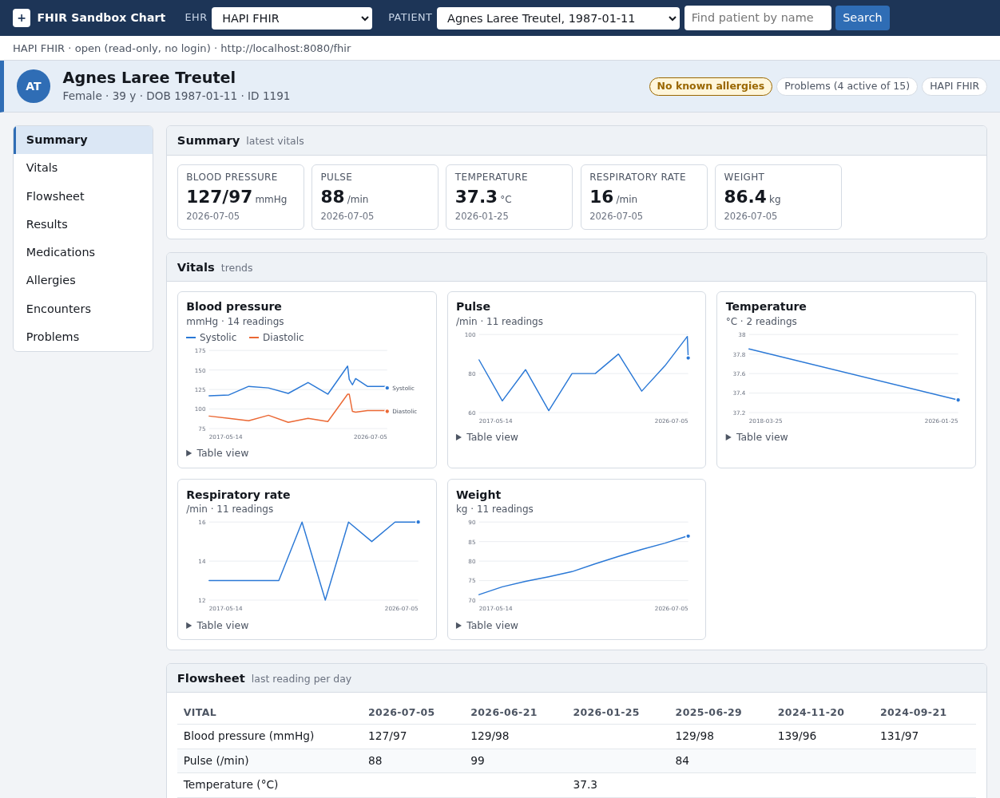

# Local HAPI Server (Synthea data)

Run your own [HAPI FHIR](https://hapifhir.io) R4 server in Docker and fill it with **synthetic patients** from [Synthea](https://github.com/synthetichealth/synthea). No account, no login, and the data is yours: stable, realistic (vitals, labs, medications, allergies, encounters, conditions) and free of the junk on the public test server.

## Requirements

[Docker](https://docs.docker.com/get-docker/) running on your machine. Nothing else to install: HAPI and Synthea both run from Docker images (Synthea needs Java 17, which comes from its image).

## Start the server and load patients

```bash
pixi run hapi-up        # starts HAPI at http://localhost:8080/fhir (first start pulls the image)
pixi run hapi-load      # generates 25 Synthea patients and loads them (about 2 minutes)
```

`hapi-load` downloads the Synthea jar (about 200 MB) into `data/synthea/` the first time (gitignored), generates the patients, and posts them to HAPI. Options:

| Option | Default | Description |
|---|---|---|
| `--patients`, `-p` | `25` | Living patients to generate (Synthea also creates some who died during the simulation, so you get a few more) |
| `--seed`, `-s` | `42` | Random seed; the same seed gives the same patients |
| `--state` | `Massachusetts` | US state to simulate |
| `--plain-names` / `--numbered-names` | plain | Synthea's own names carry random digits to look obviously fake (`Erin498 Sulema841 McClure239`); plain names (`Erin Sulema McClure`) are the default. Plain names are synthetic but could match real people. |
| `--force` | off | Load even when the server already has patients (adds more) |

Patients are stored in a Docker volume, so they survive restarts. To stop the server or start over:

```bash
pixi run hapi-down                 # stop; patients are kept
pixi run hapi-down --delete-data   # stop and delete all patients
```

## Use it

```bash
pixi run list-patients --ehr hapi              # FHIR ids and names on the server
pixi run patient --ehr hapi                    # first patient
pixi run observations --ehr hapi               # first patient, laboratory results
pixi run observations <fhir-id> --ehr hapi --category vital-signs
pixi run smart-app --ehr hapi                  # the dashboard, on your local data
```

HAPI has no fixed test patients, so the commands use the server's own patients (`list-patients` shows them).

`pixi run smart-app` uses the local server for the HAPI profile whenever it is running, else the public `hapi.fhir.org` test server. To point the Python commands and the dashboard at a different server, set it in `.env`:

```
EHR_TYPE=hapi
HAPI_FHIR_BASE=http://localhost:8080/fhir
```



## Troubleshooting

| Symptom | Fix |
|---|---|
| `Could not start HAPI` | Check `docker ps` and `docker logs ehr-hapi`. Port 8080 must be free. |
| `HAPI is not running` from `hapi-load` | Run `pixi run hapi-up` first. |
| `The server already has N patients` | Use `--force` to add more, or `pixi run hapi-down --delete-data` to start empty. |
| Dashboard still shows the public server | Start the dashboard after `hapi-up`; `smart-app` checks for the local server when it starts. |
